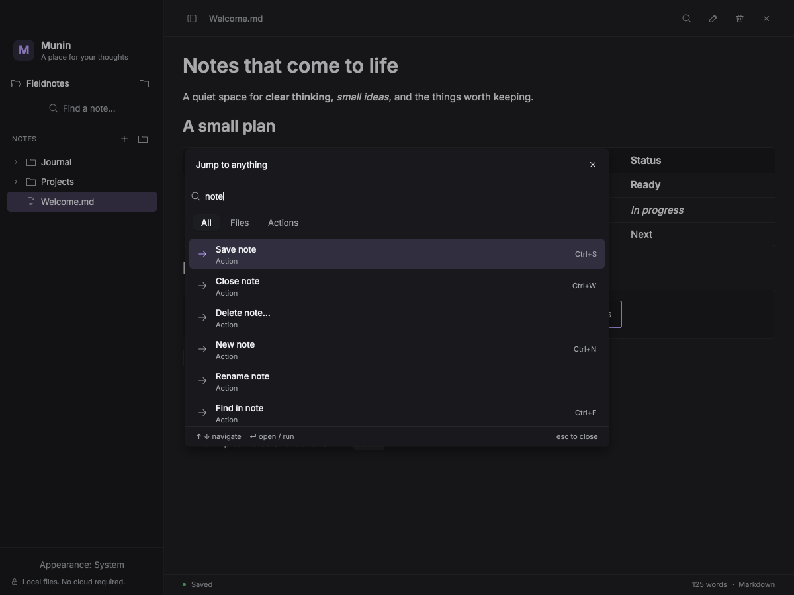

# Munin

A local Markdown workspace built with Rust, Rune and RuneKit. Your notes stay plain `.md` files—no account, server or cloud required.

## One document, live preview

Headings, emphasis, lists, quotes, code, tables and Mermaid render directly in the editor. Click a block to reveal and edit its Markdown **in place**; the surrounding document stays rendered. Move to another block or press Escape to finish editing. There is no separate Write/Read pane or toolbar toggle.


Edits patch the exact source bytes, preserving surrounding whitespace, CRLF and Unicode. Undo works across blocks. Blank-line entry continues into a new live paragraph; boundary arrows move between blocks. Ctrl/Cmd+A exposes a full-document source selection surface for native copy, cut, paste and cross-block selection; Escape returns to live preview.

This is native **block-level** live preview, not a complete clone of Obsidian/CodeMirror. Active blocks expose their Markdown syntax; tables and diagrams expose their source when edited. Reading arbitrary cross-block mouse selections is not a rich-text editing feature—use the full-document selection surface for those operations.

Mermaid renders locally without JavaScript, a browser or network service. Unsupported diagram syntax stays readable as code. Remote images are not downloaded automatically. Task checkboxes are rendered read-only; use the palette's **Toggle task checkbox** action or edit their Markdown.

[Dark live preview](docs/images/workspace-dark.png) · [Table editing](docs/images/live-table-edit.png) · [Narrow layout](docs/images/workspace-narrow.png) · [Sample note](docs/examples/rendered-note.md)

## Jump between files and actions

**Ctrl/Cmd+K** opens the combined launcher. Search by name or fuzzy initials, use ↑/↓ and Enter, or click a result. The **All**, **Files** and **Actions** tabs filter the list; prefix a query with `>` for actions or `/` for files. Shortcuts appear beside commands. Escape or an outside click dismisses the palette and returns editor focus.



**Ctrl/Cmd+O** is a file-only quick switcher with recent notes first. **Ctrl/Cmd+P** opens actions. **Ctrl/Cmd+F** searches the current unsaved note and jumps to the selected match. The palette includes formatting, headings, links, task checkboxes, note/folder creation, rename/delete, workspace selection, appearance, refresh and undo/redo. Actions unavailable in the current workspace are disabled.

[File switcher](docs/images/file-switcher.png) · [Light palette](docs/images/command-palette-light.png)

## Shortcuts

`Ctrl` on Windows/Linux; `Cmd` on macOS. Supported bindings follow Obsidian's command palette, quick switcher and editing conventions. **K is deliberately overridden for the combined launcher requested for Munin**, rather than Obsidian's insert-link shortcut; insert links through the palette.

| Shortcut | Action |
| --- | --- |
| Ctrl/Cmd+K | Files and actions |
| Ctrl/Cmd+P | Command palette |
| Ctrl/Cmd+O | Quick switcher |
| Ctrl/Cmd+F | Find in note |
| Ctrl/Cmd+N | New note |
| Ctrl/Cmd+S | Save |
| Ctrl/Cmd+W | Close note |
| Ctrl/Cmd+B / I | Toggle bold / italic |
| Ctrl/Cmd+E | Edit / finish the current block in place |
| Ctrl/Cmd+Shift+K | Delete current line |
| Ctrl/Cmd+Backslash | Toggle left sidebar |
| Ctrl/Cmd+Z | Undo |
| Ctrl/Cmd+Shift+Z | Redo (Ctrl+Y also works on Windows/Linux) |

Native clipboard and character/word/line selection shortcuts remain available. Ctrl+Home/End on Windows/Linux and Cmd+Up/Down on macOS navigate the document, not just the active block. Open the workspace folder with the sidebar folder button or the **Open workspace folder** palette action.

## Workspace and safety

Right-click the sidebar or its entries for file/folder/workspace actions. Context actions target the clicked entry, not whichever note is active. Folder deletion is confirmation-gated and **empty-only**, including hidden non-Markdown files. The sidebar reserves native traffic-light space on macOS; hiding it moves header controls clear of the buttons, and fullscreen reclaims the space.

Changes save after a pause and before switching files. Disk conflicts preserve your buffer instead of knowingly overwriting external edits. Failed saves on close attempt a local recovery copy. Workspace, current note and appearance are remembered; launcher recents are session-local. Rename actions update recent paths too.

## Run and develop

```sh
cargo run --release
```

Linux folder selection uses the XDG desktop portal. Build dependencies include `libxkbcommon-dev` on Debian/Ubuntu.

```sh
cargo fmt --check
cargo test
cargo clippy --all-targets -- -D warnings
cargo build
```

See [UI verification](docs/ui-verification.md) for headless checks, screenshots and known platform limitations. Rune is pre-release and pinned to a Git revision; Linux is the development platform. Native macOS/Windows behavior requires verification on those systems.
