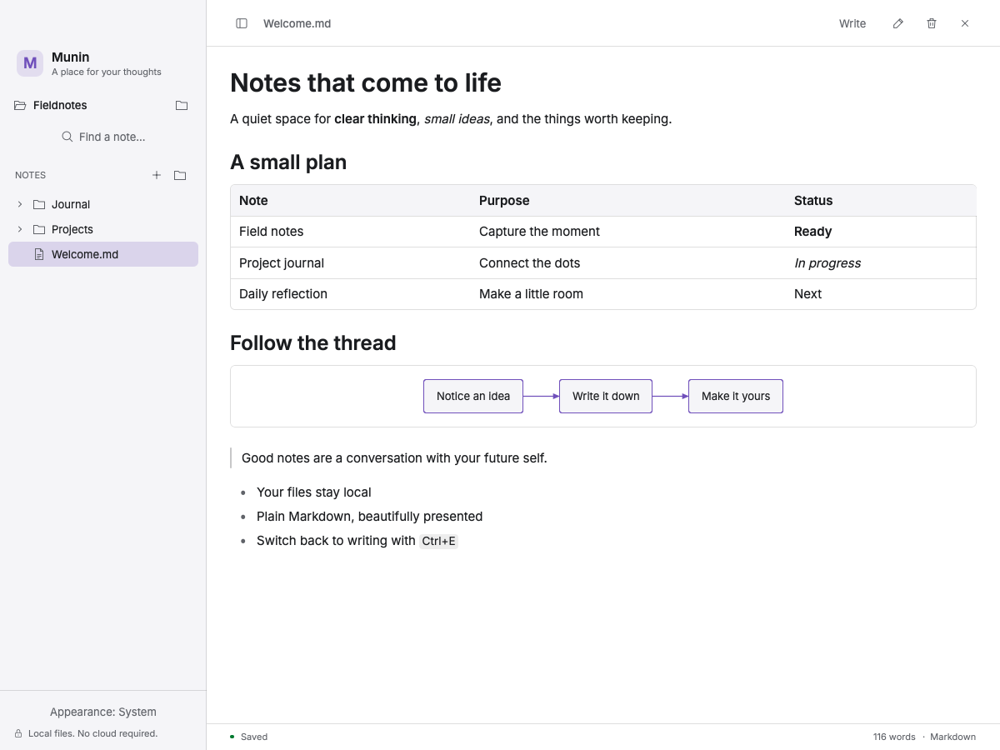

# Munin

Munin is a local Markdown editor built with Rust, Rune, and RuneKit. Notes are plain `.md` files in a folder you choose. Munin does not require an account, server, or network connection to edit notes.

## A quieter writing space

A full-width, full-height editor with a continuous white or charcoal surface, violet accents, a compact file explorer, and a word count / save-status bar. Use the header's sidebar button (or Ctrl/Cmd+B) for distraction-free writing. New note and folder actions live beside **Notes**; rename, delete, and close are in the note header. Escape or Cancel dismisses a dialog and returns focus to your note.



[Dark appearance](docs/images/workspace-dark.png) · [Sidebar hidden](docs/images/focus.png) · [Narrow window](docs/images/workspace-narrow.png) · [Long-note scrolling](docs/images/long-note-scrolled.png) · [Welcome screen](docs/images/welcome.png)

### Markdown, without losing the source

Write mode styles headings, **bold**, *italic*, links and inline code while keeping the exact Markdown syntax editable. Use **Read** / **Write** in the header or **Ctrl/Cmd+E** for a fully rendered Reading view: headings, emphasis, lists, quotes, fenced code, tables and native Mermaid diagrams. Reading renders unsaved edits too; switching modes never reserializes your note. This is a source editor plus Reading view, not a hidden-marker live-preview editor.

Mermaid blocks render locally—no browser, JavaScript, or network service. Unsupported diagram syntax falls back to its source. Wide tables/code can scroll horizontally; diagrams adapt to the available pane width. Remote images are not downloaded automatically. Reading-view task checkboxes are read-only; edit their Markdown in Write mode.

Right-click the sidebar background for workspace actions. Right-click any note or folder to open/expand, create notes or folders in that location, rename, confirm deletion, or copy its relative path. Right-clicking another note does not switch away from your buffer. Folder deletion is **empty-only**, including files hidden by the Markdown-only tree.

The macOS sidebar reserves a draggable strip for overlaid traffic lights; hiding the sidebar shifts header controls clear of them, and fullscreen reclaims the space.

[Dark Reading view](docs/images/reading-dark.png) · [Sidebar context menu](docs/images/sidebar-context.png) · [Narrow Reading view](docs/images/reading-narrow.png)

## Run

Install a recent Rust toolchain, then run:

```sh
cargo run --release
```

The first build downloads the pinned Rune revision and Rust dependencies. Linux folder selection uses the XDG desktop portal and a compatible file chooser. The application runs offline after it is built.

Open a folder to create or edit notes. The sidebar shows folders and Markdown files; the quick-open dialog searches their paths. New note and folder names can include a relative folder path, such as `projects/ideas`.

## Shortcuts

| Shortcut | Action |
| --- | --- |
| Ctrl/Cmd+O | Open workspace |
| Ctrl/Cmd+N | New note |
| Ctrl/Cmd+S | Save now |
| Ctrl/Cmd+B | Toggle sidebar |
| Ctrl/Cmd+P | Quick open |
| Ctrl/Cmd+E | Toggle Write / Read |
| Ctrl/Cmd+W | Close note |

The theme button cycles through system, light, and dark. Munin remembers the last workspace, note, and theme in the user's configuration directory.

Changes save after a short pause and before changing notes. If the file has changed on disk, Munin keeps the edited buffer and reports a conflict rather than knowingly overwriting the external version. Copy your edits elsewhere or restore the original file contents before retrying save. If saving fails when the window closes, Munin attempts to keep a local recovery copy and restores it on the next launch.

## Development

```sh
cargo fmt --check
cargo test
cargo clippy --all-targets -- -D warnings
cargo build
```

Linux builds need the XKB development library (`libxkbcommon-dev` on Debian/Ubuntu). Headless UI checks and screenshot instructions are in [UI verification](docs/ui-verification.md).

Rune is a pre-release framework pinned to a Git revision. Linux is the primary development and test platform; Windows and macOS builds and native behavior require verification on those platforms.
