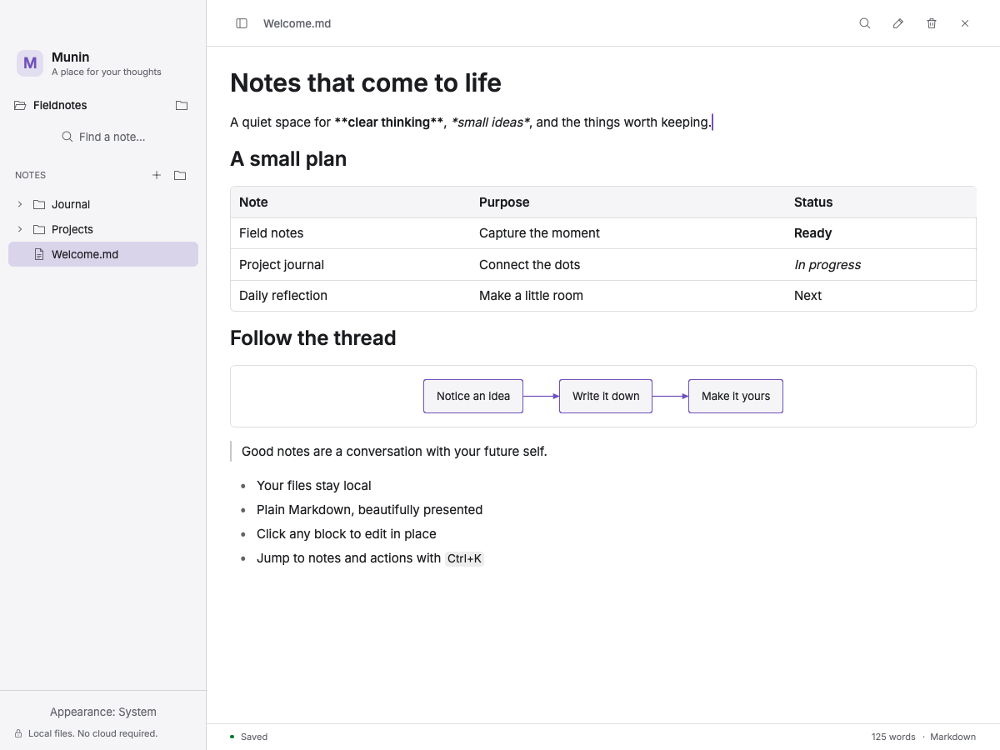
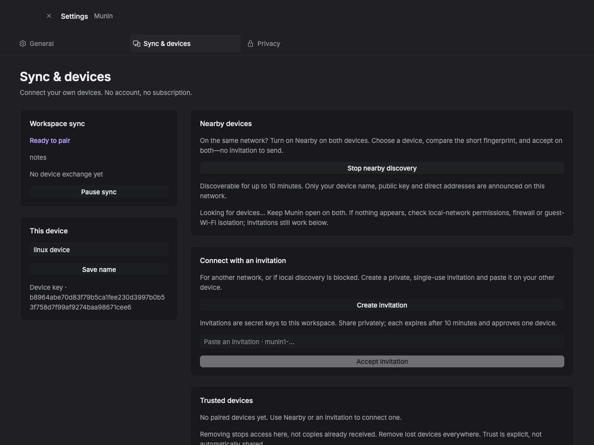

# Munin

A local Markdown workspace built with Rust, Rune and RuneKit. Your notes stay plain `.md` files—no account, server or cloud required.

## One document, live preview

Headings, emphasis, lists, quotes, code, tables and Mermaid render directly in the editor. Click a block to reveal and edit its Markdown **in place**; the surrounding document stays rendered. Move to another block or press Escape to finish editing. There is no separate Write/Read pane or toolbar toggle.



Edits patch the exact source bytes, preserving surrounding whitespace, CRLF and Unicode. Undo works across blocks. Blank-line entry continues into a new live paragraph; boundary arrows move between blocks. Ctrl/Cmd+A exposes a full-document source selection surface for native copy, cut, paste and cross-block selection; Escape returns to live preview.

This is native **block-level** live preview, not a complete clone of Obsidian/CodeMirror. Active blocks expose their Markdown syntax; tables and diagrams expose their source when edited. Reading arbitrary cross-block mouse selections is not a rich-text editing feature—use the full-document selection surface for those operations.

Code previews include a **Copy** button for fenced and indented snippets, including snippets inside quotes/lists. It copies the displayed code without the fences and does not enter edit mode. [Code-copy preview](docs/images/markdown-copy-dark.png).

Mermaid renders locally without JavaScript, a browser or network service. Unsupported diagram syntax stays readable as code. Remote images are not downloaded automatically. Task checkboxes are rendered read-only; use the palette's **Toggle task checkbox** action or edit their Markdown.

[Dark live preview](docs/images/workspace-dark.png) · [Table editing](docs/images/live-table-edit.png) · [Narrow layout](docs/images/workspace-narrow.png) · [Sample note](docs/examples/rendered-note.md)

## Jump between files and actions

**Ctrl/Cmd+K** opens the combined launcher. Search by name or fuzzy initials, use ↑/↓ and Enter, or click a result. The **All**, **Files** and **Actions** tabs filter the list; prefix a query with `>` for actions or `/` for files. Shortcuts appear beside commands. Escape or an outside click dismisses the palette and returns editor focus.


**Ctrl/Cmd+O** is a file-only quick switcher with recent notes first. **Ctrl/Cmd+P** opens actions. **Ctrl/Cmd+F** searches the current unsaved note and jumps to the selected match. The palette includes formatting, headings, links, task checkboxes, note/folder creation, rename/delete, workspace selection, appearance, refresh and undo/redo. Actions unavailable in the current workspace are disabled.

[File switcher](docs/images/file-switcher.png) · [Light palette](docs/images/command-palette-light.png)

## Shortcuts

`Ctrl` on Windows/Linux; `Cmd` on macOS. Supported bindings follow Obsidian's command palette, quick switcher and editing conventions. **K is deliberately overridden for the combined launcher requested for Munin**, rather than Obsidian's insert-link shortcut; insert links through the palette.

| Shortcut | Action |
| --- | --- |
| Ctrl/Cmd+K | Files and actions |
| Ctrl/Cmd+P | Command palette |
| Ctrl/Cmd+O | Quick switcher |
| Ctrl/Cmd+F | Find in note |
| Ctrl/Cmd+, | Settings and device sync |
| Ctrl/Cmd+N | New note |
| Ctrl/Cmd+S | Save |
| Ctrl/Cmd+W | Close note |
| Ctrl/Cmd+B / I | Toggle bold / italic |
| Ctrl/Cmd+E | Edit / finish the current block in place |
| Ctrl/Cmd+Shift+K | Delete current line |
| Ctrl/Cmd+Backslash | Toggle left sidebar |
| Ctrl/Cmd+Z | Undo |
| Ctrl/Cmd+Shift+Z | Redo (Ctrl+Y also works on Windows/Linux) |

Native clipboard and character/word/line selection shortcuts remain available. Ctrl+Home/End on Windows/Linux and Cmd+Up/Down on macOS navigate the document, not just the active block. Open the workspace folder with the sidebar folder button or the **Open workspace folder** palette action.

## Workspace and safety

Right-click the sidebar or its entries for file/folder/workspace actions. Context actions target the clicked entry, not whichever note is active. Folder deletion is confirmation-gated and **empty-only**, including hidden non-Markdown files. The sidebar reserves native traffic-light space on macOS; hiding it moves header controls clear of the buttons, and fullscreen reclaims the space.

Changes save after a pause and before switching files. Disk conflicts preserve your buffer instead of knowingly overwriting external edits. Failed saves on close attempt a local recovery copy. Workspace, current note and appearance are remembered; launcher recents are session-local. Rename actions update recent paths too.

## Your notes, on your devices

Open **Settings & device sync** in the sidebar, use the header gear with the sidebar hidden, or press **Ctrl/Cmd+,**. Desktop settings has **General**, **Sync & devices**, and **Privacy** tabs. Sync uses a compact workspace/identity column beside a wider connection panel; appearance and privacy explanations live in their own tabs.



### On the same network: no invitation to send

1. Open a workspace on each device and choose **Enable device sync**.
2. In **Sync & devices**, choose **Find nearby devices** on both.
3. Choose **Connect** beside the other device. Compare the short verification fingerprint shown on both screens, then **Accept on both devices**. Requests expire after 90 seconds; discovering a name alone never grants access.
4. Keep both Sync tabs open until the first exchange completes. A short rune-fx sparkle/glow celebrates the new pairing once—not every autosync. Reduced motion keeps the success message without travelling effects.

Nearby advertises your device name, public endpoint key and direct IP addresses over local multicast for at most ten minutes. It stays active if you leave settings, until you stop discovery, pause sync, switch workspace, close Munin or the window expires. It publishes no workspace names, notes, invitation capabilities or private keys. Already-trusted devices can refresh their local connection routes without approving again. Guest Wi-Fi isolation, blocked multicast, firewalls or denied local-network permission can prevent discovery.

### Other networks or blocked discovery: invitation fallback

Choose **Create invitation**, then **Copy invitation**. Privately send it to the other device, paste it into the invitation field and choose **Accept invitation**. Long codes stay selectable inside their own scroll area; Copy/Revoke remain outside the selection. Each invitation expires after ten minutes and approves one device. Completing a new nearby pairing revokes any unused invitation that is cleared from the UI.

After pairing, edit offline as usual; paired devices retry automatically when both are available.

No account or hosted document service is required. **Automerge** merges concurrent text edits; **iroh** provides authenticated, end-to-end encrypted QUIC connections with direct links and relay fallback. Settings reports the last successful exchange and individual device errors—not merely whether sync was enabled. Existing notes on both devices are kept; colliding filenames get deterministic `(conflict …)` copies. Concurrent edits survive a concurrent deletion. Renames propagate when removed/added content identifies a unique match; otherwise they become delete/create operations.

[General tab](docs/images/settings-general-light.png) · [Privacy tab](docs/images/settings-privacy-dark.png) · [Invitation fallback](docs/images/sync-pairing-dark.png) · [Pairing FX preview](docs/images/pairing-success-rune-fx.png) · [Narrow fallback](docs/images/sync-settings-narrow-light.png)

### Privacy, trust and recovery

- Sync is **opt-in per workspace**. Pause stops its network worker without removing notes, device trust or merge history. Even filesystem errors do not prevent pausing.
- Pairing grants access to the **whole selected Markdown workspace**, including retained CRDT history. Treat invitation codes as secrets.
- Trust is explicit, not transitive. Pair the devices that should exchange directly. A connected intermediate device can carry merged history, but if it is offline, devices without a pairing cannot talk directly.
- **Remove** revokes that endpoint's access on this device and closes existing sessions. It does not erase copies already received or revoke access through other trusted devices; remove a lost device everywhere.
- iroh's default public relays and address discovery can observe connection metadata. Relays cannot read note contents. Notes, private keys and CRDT history are **not encrypted at rest**.
- Private local state lives in `.munin-sync/`, excluded from the browser and sync. **Never copy that directory to a different device**; pair it instead. On Unix the directory is owner-only and newly created metadata files are private. Only one Munin process can sync a given workspace.
- This is sync, **not a backup**: deletions propagate and history can include deleted text. Back up your workspace separately. If metadata is damaged, pause sync, close Munin and back up the Markdown files **and** `.munin-sync` before repairing/restoring it. Resetting metadata creates a new identity/history and requires re-pairing; do not reset one peer casually.
- Markdown only: attachments, empty folders, symlinks and nonportable paths are not synced. Limits: 8 MiB per note, 32 MiB total note text / saved sync history, 10,000 note records including tombstones, and 64 approved devices. Over-limit or unsafe inputs show errors rather than being silently skipped.
- Incoming changes preserve buffered edits, but reset the current note's stale undo history when its source changes remotely. Both apps must run at overlapping times; sync does not continue after closing Munin.

## Run and develop

```sh
cargo run --release
```

Linux folder selection uses the XDG desktop portal. Build dependencies include `libxkbcommon-dev` on Debian/Ubuntu.

```sh
cargo fmt --check
cargo test
cargo clippy --all-targets -- -D warnings
cargo build
```

See [UI verification](docs/ui-verification.md) for headless checks, screenshots and known platform limitations. Rune is pre-release and pinned to a Git revision; Linux is the development platform. Native macOS/Windows behavior requires verification on those systems.
